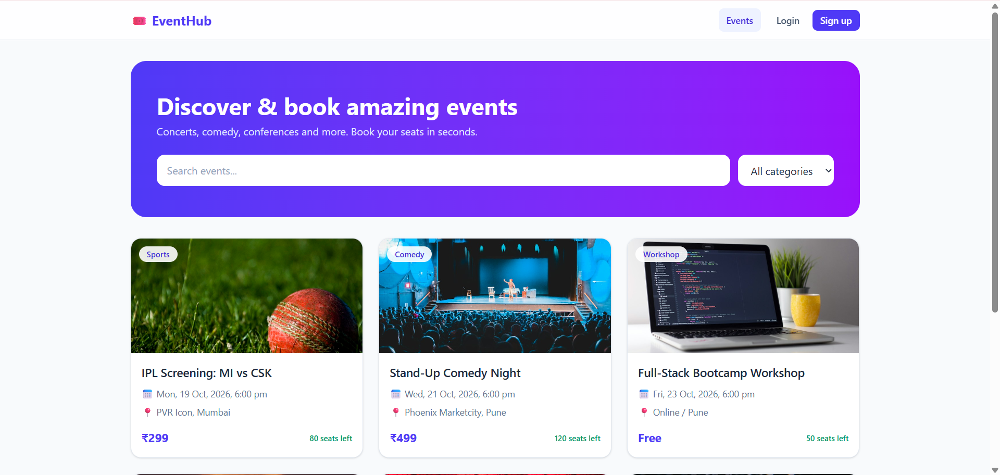
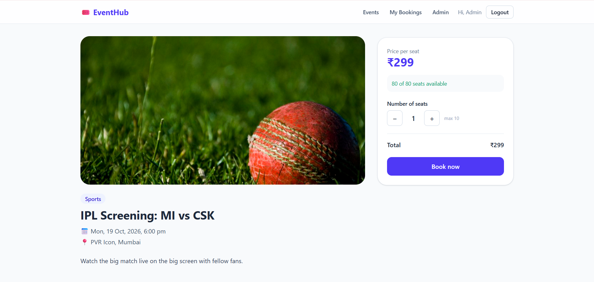
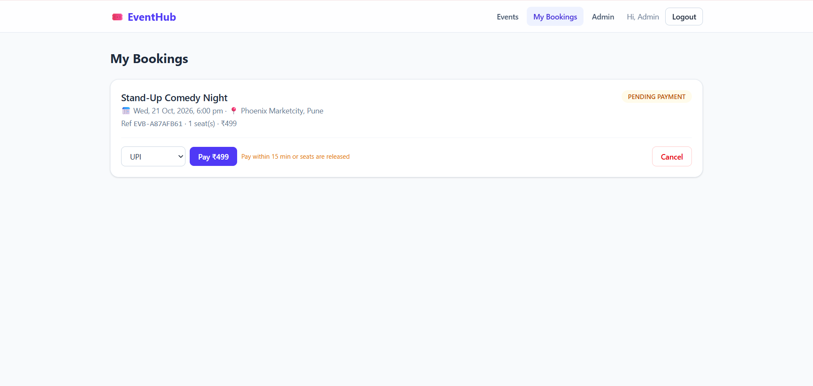
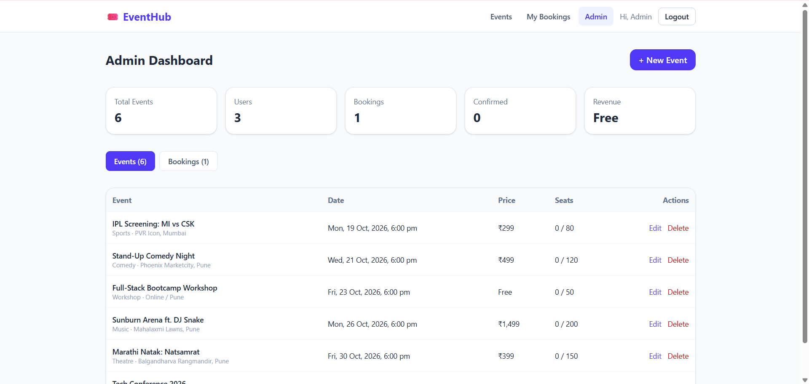
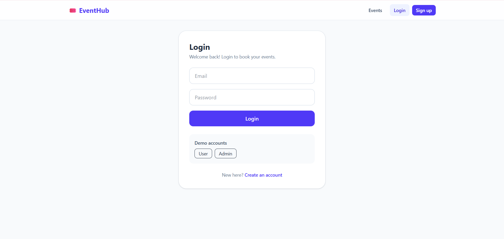

# 🎟️ EventHub – Event Booking Management System

A full-stack event booking platform where users can discover events, reserve seats, pay and manage bookings, and admins can manage events and track bookings and revenue.

**Built with Spring Boot, React and MySQL.** The core focus is **safe concurrent seat booking**: two users can never book the same last seat.

> 🔗 **Live Demo:** _coming soon_
> 👤 **Demo login:** User `demo@eventbooking.com` / `demo123` · Admin `admin@eventbooking.com` / `admin123`



---

## ✨ Features

**Users**
- Register / login with **JWT authentication**
- Browse upcoming events with **search** and **category filter**
- Book 1–10 seats with live seat availability
- Pay for a booking (UPI / Card / Net Banking) and get a confirmation email
- View booking history and cancel bookings (seats are released automatically)

**Admin**
- Dashboard with total events, users, bookings, confirmed bookings and revenue
- Create, edit and delete events
- View and cancel any booking

**Backend highlights**
- 🔒 **No double booking:** seat updates use a database row lock (`PESSIMISTIC_WRITE` → `SELECT ... FOR UPDATE`) plus optimistic locking (`@Version`)
- ⏱️ **Auto-release:** unpaid bookings expire after 15 minutes and their seats go back to the pool (`@Scheduled` job)
- 🛡️ **Role-based access** (`USER` / `ADMIN`) with Spring Security
- ✅ Request validation and a global exception handler with clean JSON errors
- 📧 Async email notifications (`@Async`, logs to console when mail is disabled)
- 🧪 Unit tests with **JUnit 5 + Mockito**

---

## 🛠️ Tech Stack

| Layer | Technologies |
|---|---|
| **Backend** | Java 17, Spring Boot 4, Spring Security, Spring Data JPA (Hibernate), JWT (jjwt), Bean Validation, Java Mail, Lombok |
| **Frontend** | React 19, Vite, React Router, Axios, Tailwind CSS, React Hot Toast |
| **Database** | MySQL 8 |
| **Testing** | JUnit 5, Mockito, AssertJ |
| **DevOps** | Docker, Render (backend), Vercel (frontend) |

---

## 🏗️ Architecture

```
React (Vite)  ──HTTP/JSON + JWT──▶  Spring Boot REST API  ──JPA──▶  MySQL
                                     │
                                     ├── controller   → REST endpoints
                                     ├── service      → business logic, locking, payments
                                     ├── repository   → Spring Data JPA
                                     ├── security     → JWT filter, user details
                                     └── exception    → global error handling
```

### Booking flow

```
Book seats ──▶ PENDING_PAYMENT ──pay──▶ CONFIRMED ──cancel──▶ CANCELLED (refund)
   (row lock,          │
    seats reserved)    └── not paid in 15 min ──▶ CANCELLED (seats released)
```

---

## 📡 API Endpoints

| Method | Endpoint | Access | Description |
|---|---|---|---|
| POST | `/api/auth/register` | Public | Register a new user |
| POST | `/api/auth/login` | Public | Login and get a JWT |
| GET | `/api/users/me` | User | Current user profile |
| GET | `/api/events?q=&category=` | Public | Upcoming events with search/filter |
| GET | `/api/events/{id}` | Public | Event details |
| GET | `/api/events/categories` | Public | All categories |
| POST | `/api/events` | Admin | Create event |
| PUT | `/api/events/{id}` | Admin | Update event |
| DELETE | `/api/events/{id}` | Admin | Delete event (only if no bookings) |
| POST | `/api/bookings` | User | Reserve seats |
| GET | `/api/bookings/my` | User | My bookings |
| POST | `/api/bookings/{id}/pay` | User | Pay for a booking |
| POST | `/api/bookings/{id}/cancel` | User / Admin | Cancel a booking |
| GET | `/api/admin/stats` | Admin | Dashboard stats |
| GET | `/api/admin/events` | Admin | All events |
| GET | `/api/admin/bookings` | Admin | All bookings |

---

## 📸 Screenshots

| Event Details & Seat Booking | My Bookings & Payment |
|---|---|
|  |  |

| Admin Dashboard | Login |
|---|---|
|  |  |

---

## 🚀 Run Locally

### Prerequisites
Java 17+, Maven, Node.js 18+, MySQL 8

### 1. Backend
```bash
cd event-booking-system
```
Create `src/main/resources/secret.properties` (git-ignored) with your MySQL password:
```properties
spring.datasource.password=your_mysql_password
```
Then run:
```bash
./mvnw spring-boot:run
```
The API starts on `http://localhost:5698`. The `eventbooking` database, tables, demo users and sample events are created automatically on first run.

### 2. Frontend
```bash
cd event-booking-frontend
npm install
npm run dev
```
Open `http://localhost:5173`.

### 3. Run tests
```bash
cd event-booking-system
./mvnw test
```

---

## ⚙️ Environment Variables (production)

**Backend**

| Variable | Description |
|---|---|
| `DB_URL` | JDBC URL of the MySQL database |
| `DB_USERNAME` / `DB_PASSWORD` | Database credentials |
| `JWT_SECRET` | Secret key for signing JWTs (32+ characters) |
| `CORS_ORIGINS` | Allowed frontend URL(s), comma separated |
| `PORT` | Server port (set by the host) |

**Frontend**

| Variable | Description |
|---|---|
| `VITE_API_URL` | Backend base URL, e.g. `https://your-api.onrender.com` |

---

## 📌 Notes
- Payments use a **simulated gateway** (`PaymentService`) that returns a transaction ID. It is isolated so it can be swapped for Razorpay/Stripe.
- Emails are logged to the console unless `MAIL_ENABLED=true` and SMTP settings are provided.

---

## 👤 Author
**Shreyas Awdhal** · [GitHub](https://github.com/shreyas-awdal-7)
